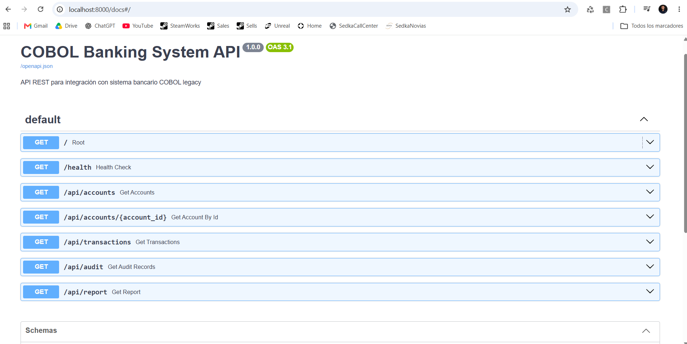
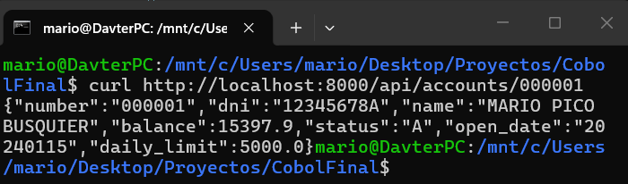

# COBOL Banking Batch System

Sistema de procesamiento batch bancario desarrollado en COBOL que gestiona transacciones financieras, validaciones de cuentas, cálculo de comisiones y generación de informes profesionales.

## 📋 Descripción del Proyecto

Este sistema procesa diariamente movimientos bancarios (transferencias, ingresos, retiradas y pagos) aplicando validaciones de negocio, calculando comisiones y generando informes detallados. Diseñado siguiendo estándares empresariales de COBOL con manejo robusto de errores y trazabilidad completa.

### Características Principales

- ✅ Procesamiento batch de múltiples tipos de transacciones
- ✅ Validación en cascada de cuentas y saldos
- ✅ Cálculo automático de comisiones por tipo de operación
- ✅ Generación de informes profesionales con formato financiero
- ✅ Trazabilidad completa con logs de auditoría
- ✅ Manejo robusto de errores con códigos específicos
- ✅ JCL para ejecución en mainframe IBM z/OS

## 🏗️ Arquitectura del Sistema

```
┌─────────────────────────────────────────────────────────────┐
│                    FICHEROS DE ENTRADA                       │
├─────────────────────────────────────────────────────────────┤
│  data/MOVIMIENTOS.DAT    - Movimientos del día              │
│  data/CUENTAS.DAT        - Maestro de cuentas (I-O)         │
└────────────────────────┬────────────────────────────────────┘
                         │
                         ▼
┌─────────────────────────────────────────────────────────────┐
│                 BANKPROC.cob (Programa Principal)            │
├─────────────────────────────────────────────────────────────┤
│  1. Inicialización y apertura de ficheros                    │
│  2. Bucle principal: leer movimiento                         │
│  3. Validación en cascada (E001-E007)                       │
│  4. Procesamiento de movimientos válidos                     │
│  5. Cálculo de comisiones                                    │
│  6. Actualización de saldos (REWRITE)                        │
│  7. Generación de informes                                   │
│  8. Finalización y cierre                                    │
└────────────────────────┬────────────────────────────────────┘
                         │
                         ▼
┌─────────────────────────────────────────────────────────────┐
│                    FICHEROS DE SALIDA                        │
├─────────────────────────────────────────────────────────────┤
│  output/REPORT.DAT       - Informe profesional diario       │
│  output/AUDIT.DAT        - Log de auditoría detallado       │
│  output/ERRORS.DAT       - Registro de errores              │
│  output/HISTORICO.DAT    - Histórico de operaciones         │
│  data/CUENTAS.DAT        - Saldos actualizados              │
└─────────────────────────────────────────────────────────────┘
```

## 📁 Estructura del Proyecto

```
CobolFinal/
├── cobol/                      # Programas COBOL
│   └── BANKPROC.cob           # Programa principal de batch
├── copybooks/                  # Copybooks (estructuras de datos)
│   ├── BANK-ACCOUNT.cpy       # Estructura de cuenta bancaria
│   ├── BANK-CLIENT.cpy        # Estructura de cliente
│   ├── BANK-COMMON.cpy        # Constantes globales
│   ├── BANK-ERRORS.cpy        # Códigos de error
│   └── BANK-TRANSACTION.cpy   # Estructura de transacción
├── data/                       # Ficheros de datos
│   ├── CLIENTES.DAT           # Maestro de clientes
│   ├── CUENTAS.DAT            # Maestro de cuentas
│   └── MOVIMIENTOS.DAT        # Movimientos del día
├── output/                     # Ficheros de salida (generados)
│   ├── REPORT.DAT             # Informe profesional
│   ├── AUDIT.DAT              # Log de auditoría
│   ├── ERRORS.DAT             # Registro de errores
│   └── HISTORICO.DAT          # Histórico de operaciones
├── jcl/                        # Job Control Language
│   ├── BANKJOB.jcl            # Job de ejecución principal
│   └── SORTJOB.jcl            # Job de ordenación previa
├── scripts/                    # Scripts de automatización
│   ├── compile.sh             # Compilación de programas
│   ├── run.sh                 # Ejecución del batch
│   ├── generate-test-data.sh  # Generación de datos de prueba
│   ├── verify.sh              # Verificación de integridad
│   └── run-tests.sh           # Ejecución de pruebas
├── tests/                      # Documentación de pruebas
│   ├── test-cases.md          # Casos de prueba documentados
│   └── test-results/          # Resultados de ejecución
├── docs/                       # Documentación técnica
│   ├── record-layouts.md      # Estructuras de registros
│   ├── architecture.md        # Arquitectura del sistema
│   └── error-codes.md         # Códigos de error
├── .gitignore                  # Git ignore
├── Guide.txt                   # Guía de desarrollo (Fases 0-12)
└── README.md                   # Este archivo
```

## 🔧 Requisitos

### Software Necesario

- **GnuCOBOL 3.x** o superior (compilador COBOL)
- **WSL** (Windows Subsystem for Linux) si estás en Windows
- **Bash** para scripts de automatización
- **Git** para control de versiones

### Instalación en WSL (Ubuntu)

```bash
# Actualizar repositorios
sudo apt update

# Instalar GnuCOBOL
sudo apt install gnucobol4

# Verificar instalación
cobc --version
```

## 🚀 Quick Start

### 1. Clonar el repositorio

```bash
git clone https://github.com/Davter17/Cobol.git
cd CobolFinal
```

### 2. Compilar el programa

```bash
# Opción 1: Usando el script de compilación
./scripts/compile.sh

# Opción 2: Compilación manual
cobc -x -free cobol/BANKPROC.cob
```

### 3. Generar datos de prueba (opcional)

```bash
./scripts/generate-test-data.sh
```

### 4. Ejecutar el procesamiento batch

```bash
# Opción 1: Usando el script de ejecución (recomendado)
./scripts/run.sh

# Opción 2: Ejecución directa
./BANKPROC
```

### 5. Verificar resultados

```bash
# Verificación completa de integridad
./scripts/verify.sh

# Ver el informe generado
cat output/REPORT.DAT
```

## 📸 Demostración Visual

### 🎥 Ejecución del Sistema COBOL

<video src="images/ejecucion.mp4" controls width="100%"></video>

*Procesamiento batch de 58 movimientos con validación en cascada*

### 🎥 Verificación Automática

<video src="images/verificacion.mp4" controls width="100%"></video>

*29 pruebas de integridad pasando correctamente*

### Documentación de la API (Swagger UI)



*Documentación interactiva de los endpoints REST generada automáticamente por FastAPI*

### Respuesta JSON de la API



*Datos leídos directamente de ficheros COBOL y convertidos a JSON*

---

## 📊 Ejemplo de Output

### Informe Profesional (REPORT.DAT)

```
================================================================================

              COBOL BANKING SYSTEM
            DAILY BANKING REPORT

================================================================================
  BANK CODE: 0001
  REPORT DATE: 2026-10-29

================================================================================

  PROCESSING SUMMARY
--------------------------------------------------------------------------------
  TOTAL MOVEMENTS PROCESSED: 000058
  ACCEPTED:                    000035
  REJECTED:                    000023
  ACCOUNTS UPDATED:            0035

  OPERATIONS BY TYPE
--------------------------------------------------------------------------------
  TRANSFERS:   000023
  DEPOSITS:    000006
  WITHDRAWALS: 000006
  PAYMENTS:    000000

  FINANCIAL SUMMARY
--------------------------------------------------------------------------------
  TOTAL DEBITED:            8,205.36 EUR
  TOTAL CREDITED:          12,730.61 EUR
  TOTAL COMMISSIONS:           24.40 EUR

  ERRORS BREAKDOWN
--------------------------------------------------------------------------------
  E001 - ACCOUNT NOT FOUND:    0006
  E002 - INSUFFICIENT BALANCE: 0008
  E003 - ACCOUNT BLOCKED:      0005
  E004 - INVALID AMOUNT:       0001
  E005 - DUPLICATE MOVEMENT:   0000
  E006 - ACCOUNT INACTIVE:     0003
  E007 - DAILY LIMIT EXCEEDED: 0000

--------------------------------------------------------------------------------
  END OF REPORT
--------------------------------------------------------------------------------
```

### Log de Auditoría (AUDIT.DAT)

```
20261029 162645 0000000001 T 000001 000002        500.00  K        0.50 TRANSFERENCIA ENTRE CUENTAS
20261029 162645 0000000002 T 000002 000003        250.50  K        0.50 PAGO SERVICIOS
20261029 162645 0000000041 T 999999 000001        100.00  E001         CUENTA INEXISTENTE ORIGEN
```

## 🧪 Testing

### Ejecutar pruebas automáticas

```bash
# Ejecutar todos los casos de prueba
./scripts/run-tests.sh

# Verificar integridad de datos
./scripts/verify-integrity.sh
```

### Casos de prueba documentados

Ver `tests/test-cases.md` para 17 casos de prueba detallados:
- 5 happy path (transacciones válidas)
- 7 error path (validaciones de error)
- 5 edge cases (casos límite)

## 📖 Documentación Técnica

- **[Record Layouts](docs/record-layouts.md)** - Estructuras de registros byte a byte
- **[Arquitectura](docs/architecture.md)** - Diagrama y flujo del sistema
- **[Códigos de Error](docs/error-codes.md)** - Referencia completa de errores E001-E010

## 💼 Reglas de Negocio

### Tipos de Operación

| Tipo | Código | Descripción |
|------|--------|-------------|
| Transferencia | T | Transferencia entre cuentas |
| Ingreso | I | Depósito en cuenta |
| Retirada | R | Extracción de efectivo |
| Pago | P | Pago a proveedor |

### Comisiones

| Tipo de Operación | Comisión |
|-------------------|----------|
| Transferencia | 0.1% del importe (mínimo 0.50 EUR) |
| Retirada | 2.00 EUR fija |
| Ingreso | Gratis (0.00 EUR) |
| Pago | 0.05% del importe |

### Validaciones

1. **E001** - Cuenta origen/destino no encontrada
2. **E002** - Saldo insuficiente en cuenta origen
3. **E003** - Cuenta origen/destino bloqueada
4. **E004** - Importe inválido (≤ 0 o excede máximo)
5. **E005** - Movimiento duplicado (ID repetido)
6. **E006** - Cuenta origen/destino inactiva
7. **E007** - Importe excede límite diario

## 🖥️ Ejecución en Mainframe (JCL)

Para ejecutar en un mainframe IBM z/OS, usar el JCL proporcionado:

```jcl
//BANKJOB  JOB (BANK001),'COBOL BANKING BATCH',
//             CLASS=A,MSGCLASS=X,MSGLEVEL=(1,1)
//STEP1    EXEC PGM=BANKPROC
//STEPLIB  DD DSN=BANK.COBOL.LOAD,DISP=SHR
//MOVEMENTS DD DSN=BANK.DATA.MOVIMIENTOS,DISP=SHR
//ACCOUNTS DD DSN=BANK.DATA.CUENTAS,DISP=OLD
//ERRORS   DD DSN=BANK.OUTPUT.ERRORS,DISP=(NEW,CATLG,DELETE)
//HISTORIC DD DSN=BANK.OUTPUT.HISTORICO,DISP=(,CATLG,DELETE)
//REPORT   DD DSN=BANK.OUTPUT.REPORT,DISP=(NEW,CATLG,DELETE)
//AUDIT    DD DSN=BANK.OUTPUT.AUDIT,DISP=(NEW,CATLG,DELETE)
//SYSOUT   DD SYSOUT=*
```

Ver `jcl/BANKJOB.jcl` para el JCL completo con comentarios explicativos.

## 🛠️ Scripts de Automatización

| Script | Descripción |
|--------|-------------|
| `scripts/compile.sh` | Compila todos los programas COBOL |
| `scripts/run.sh` | Ejecuta el batch con backup automático |
| `scripts/generate-test-data.sh` | Genera datos de prueba realistas |
| `scripts/verify.sh` | Verifica integridad completa del sistema |
| `scripts/run-tests.sh` | Ejecuta casos de prueba documentados |

## 📈 Progreso del Desarrollo

Este proyecto sigue una metodología de desarrollo por fases:

- ✅ **Fase 0-3**: Preparación, estructura, copybooks y datos
- ✅ **Fase 4-6**: Lectura, validación y escritura de ficheros
- ✅ **Fase 7**: Programa principal (BANKPROC)
- ✅ **Fase 8**: Generación de informes profesionales
- ✅ **Fase 9**: JCL para mainframe
- ✅ **Fase 10**: Scripts de automatización
- ✅ **Fase 11**: Testing y verificación
- ✅ **Fase 12**: Documentación completa

**Total: 47/54 pasos completados (87%)**

## 🎯Conceptos COBOL Demostrados

- Divisiones: IDENTIFICATION, ENVIRONMENT, DATA, PROCEDURE
- Estructuras de datos: PIC, nivel 01/05/88, REDEFINES
- Manejo de ficheros: OPEN, READ, WRITE, REWRITE, CLOSE
- Control de flujo: PERFORM, EVALUATE, IF/ELSE
- Validaciones: FILE STATUS, niveles 88, condiciones nombradas
- Cálculos: COMPUTE, ADD, SUBTRACT, formatos de edición
- Copilibros: COPY statement, reutilización de código
- JCL: Job cards, EXEC, DD statements, DISP, catalogación

## 📝 Licencia

Proyecto desarrollado con fines educativos y de portafolio profesional.

## 👤 Autor

**Mario Pico** - Desarrollo COBOL Empresarial

---

**Estado del Proyecto:** ✅ Completado y verificado  
**Última Actualización:** Octubre 2026  
**Versión:** 1.0
